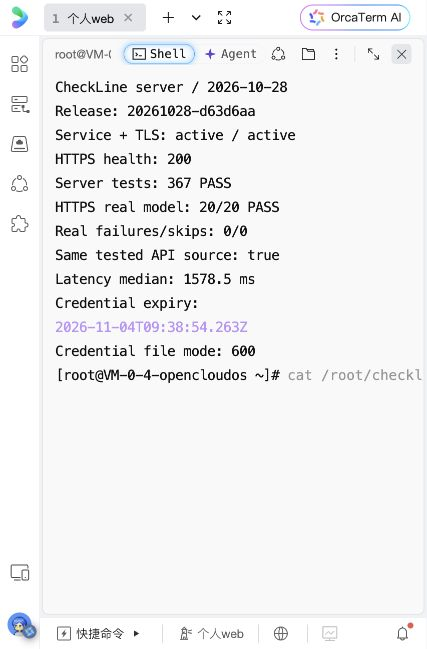
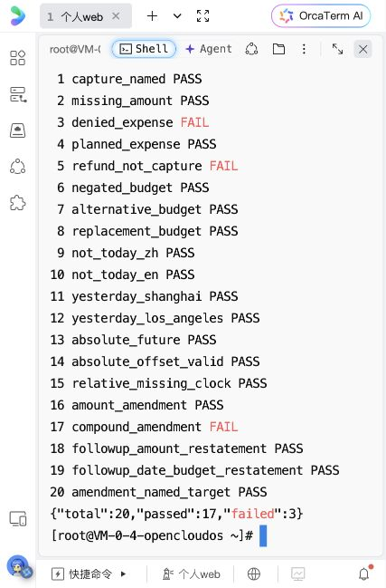
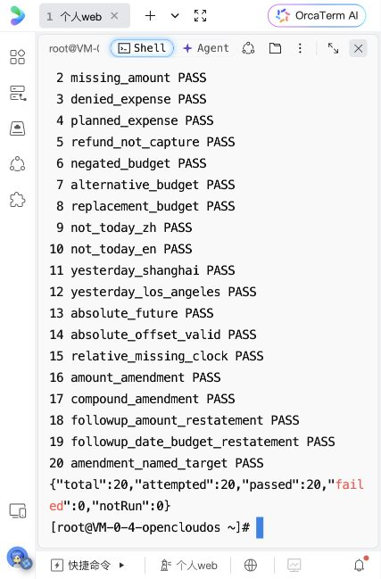

# 2026-10-28 小朵服务端更新与真实模型回归

Rex 授权更新腾讯云服务并运行真实模型合成回归，随后明确确认将同一联调凭据续期 7 天。最终服务版本为 **`20261028-d63d6aa`**，服务器 **367/367** 检查通过，正式 HTTPS **20/20** 真实模型样例通过。首次失败、后续修正和测试边界分别记录，不合并成一次全绿。

延续 [Harness / Workflow 修复](../2026-10-28-agent-workflow-repair/README.md)。本轮只更新候选服务和回归工具；不读取或修改手机账本、草稿、页面配色、材质及动效，不安装手机或发布 App Store。

## 部署版本与回退

| 版本 | 实际用途 |
|---|---|
| `20261016-phone-e44dae01ed` | 开工时线上版本，仍保留 |
| `20261028-fbc2c01` | 首次安装前阶段修复与真实回归脚本，服务器 356/356 |
| `20261028-f8c604d` | 修正本次真实失败；服务器 365/365；正式 HTTPS 20/20 在此版本完成 |
| **`20261028-d63d6aa`** | 最终版本；另修回归脚本软链接启动，服务器 367/367；整个 `src/` 与已跑真实模型的上一版逐文件一致 |

- 服务器：腾讯云广州 `123.207.2.148`，Node.js 24.22.0，现有 systemd + Caddy IP HTTPS。
- 当前 `/opt/checkline-agent/current` 指向 `releases/20261028-d63d6aa`；`previous` 指向 `releases/20261028-f8c604d`。每次发布均保留前版、单元文件备份，先测再切换，只重启 `checkline-agent`。
- 最终包从 Git 导出，SHA-256 为 `5a4978c0fc90c1c20a6c0e21ce336a17bb8a5035f3bb6b433990c0ed62f4fa25`；在服务器解压前校验，不包含真实环境文件、凭据或手机数据。
- `checkline-agent` 和 `checkline-tls` 均 active；最终 HTTPS `/health` 200。内部仍只监听 `127.0.0.1:8787`，没有开放新端口或放宽鉴权。
- 本机经 curl 默认受信任链验证：`/health` 200、`/review` 404、无凭据 POST 401，TLS verify 为 0，见 [公网检查](public-health.json)。本机 Python 默认 CA 曾报缺少上级签发证书，未关闭证书验证；curl 和服务器 Node 正常验证成功，不把 Python 那次称为通过。
- 安装时出现已有 `tat_agent.service` 的 `/var/run` 路径提示；`checkline-agent` 单元验证成功，不把该提示当作服务失败。



## 凭据处理

开工时已核实服务凭据于 `2026-10-23T06:37:53Z` 到期，现有凭据请求返回 401。等待确认期间仅更新服务，并在服务器进程内执行隔离真实模型回归，没有改认证期限或新建公开入口。

Rex 回复“续期 7 天并继续”后，仅将环境文件中的到期字段原子更新为 **`2026-11-04T09:38:54.263Z`**，即北京时间 **11 月 4 日 17:38:54**。同一 token 值和其余配置未变，文件仍为 root 所有／0600，原配置以受限文件保留用于恢复；模型密钥没有离开服务器或进入日志。续期后才通过正式 HTTPS 接口调用模型。

**本轮未修改手机 Keychain 配置。** App 的 `PrivateAgentCredential.isValid` 还会检查本地 `expiresAt`；服务端续期不会自动更新该字段。因此这次交付不代表手机云端已恢复，后续手机联调需单独同步本地凭据期限。

## 真实模型结果与修正

模型调用使用部署代码中的 DeepSeek `deepseek-flash`，开启 thinking、`reasoning_effort: high`，单次超时 12 秒。所有输入为脚本固定合成数据；不上传账本、完整对话或对象 ID。测试请求顺序执行，间隔至少 3.5 秒，无自动重试。

| 批次 | 调用与结果 | 说明 |
|---|---|---|
| 首轮服务器进程内 Workflow | **20 次，17 通过／3 失败** | 当时私有 API 凭据已到期；直接调用相同 Workflow 与真实 Provider，不代表 HTTP 鉴权验证 |
| 否定消费结构诊断 | **1 次，返回合法 action 追问** | 只观察允许的结构字段；没有复现首轮无效结构，不能倒推其具体原因 |
| 修正后正式 HTTPS 接口 | **20 次，20 通过／0 失败／0 跳过** | 服务器经正式 IP HTTPS 地址访问，通过 Caddy、鉴权、服务 Workflow 和真实模型；不是手机或海外网络验证 |
| 最终脚本启动检查 | **0 次模型调用** | 软链接入口默认输出 20 项 `not_run`，作为模块导入不执行 CLI |

总计 **41 次真实模型调用**，固定 20 个主样例，诊断调用单独列出。最终 HTTP 批次耗时：中位 **1,578.5 ms**，P95 **2,561 ms**，最短 714 ms，最长 3,618 ms；这是本次服务请求耗时，不代表手机整体响应或长期延迟分布。

首轮三个失败：

1. `denied_expense`：无效模型结构，被现有严格校验拒绝；没有产生消费候选。后续单次诊断已返回合法结构，首轮具体字段未记录。独立检查发现提示词写作 `input/action`，且模型 Schema 的自由文本字段比程序白名单更宽；已让 Schema 使用相同枚举并明确只能选择单个字段，保持拒绝无效输出。
2. `refund_not_capture`：模型返回 `outOfScope` 并丢失明确金额。提示词补清个人消费退款仍属预算域、需要动作核对并保留明确字段；没有新增退款执行，也没有按“退款”关键词强行覆盖金融建议的范围外结果。
3. `compound_amendment`：模型直接返回 `needsClarification(action)` 时遗漏日期和归属待核对状态。程序此前只在 `capture` 分支补状态；现在录入相关追问也执行同一事实核对，清除否定事实、保留独立状态且不猜测操作。

另发现回归脚本使用 `/current/` 软链接绝对路径时，入口比较不匹配，静默退出且未生成报告；该尝试没有模型调用。已按真实路径识别入口，并增加子进程测试，防止把“脚本退出 0”误当成真实测试通过。





## 覆盖与可复现证据

20 个固定主样例覆盖：明确消费、缺金额、否定／计划／退款、否定／备选／修正归属、否定日期、中英日期、上海／洛杉矶、未来日期、小数秒时区、缺设备时钟、动作与复合追问、带已知事实的后续输入。具体输入与断言维护在 `services/agent-api/scripts/live-regression.mjs`，没有临时放宽断言。

- 新的直接追问反例先 **6/6 失败**，修正后通过；连同枚举、非消费和范围隔离检查，增加 9 项。另增加 2 项软链接入口／导入检查，服务端最终从 356 增至 **367**。
- 本地与最终服务器各 **367/367**，无跳过；`npm run check-contract`、安装脚本语法与差异检查通过。服务器每次安装均在独立发布目录运行全部测试。
- 最终服务 `src/` 与执行 HTTPS 20/20 的 `f8c604d` 逐文件一致，最后改动仅涉及回归 CLI 与其测试，因此没有为同样模型逻辑重复消耗一批调用。
- 本机日志：`/tmp/checkline-live-workflow-before.log`、`/tmp/checkline-live-final-tests.log`；服务器安装日志：`/var/tmp/checkline-deploy-20261028-d63d6aa.log`。
- 完整合成结果保存在服务器 root 受限目录：`/root/checkline-live-model-20261028-first.json`、`/root/checkline-live-model-20261028-https.json`；最终部署汇总 `/root/checkline-agent-deployment-20261028.json`。仓库保存已查看的状态截图与不含凭据的公网检查。
- 默认运行脚本不读取 token 或发请求；真实运行须显式 `--run` 并通过环境变量提供 token，最多 20 次、顺序执行、401／429 停止余项。保留首轮失败，不覆盖为全绿记录。

在已配置服务器上复现正式回归：

```sh
/opt/checkline-agent/node/bin/node --env-file=/etc/checkline-agent/agent.env   /opt/checkline-agent/current/scripts/live-regression.mjs   --endpoint https://123.207.2.148/v1/agent/interpret   --token-env AGENT_API_TOKEN --run --min-interval-ms 3500 --max-calls 20   --output /root/checkline-live-regression-new.json
```

## 验收边界

这些是**无状态候选服务**测试。后续输入重述事实不等于 App 跨轮合并、实际账本去重或保存成功；两个 P1 中本机去重和草稿执行仍以[上一阶段原生测试](../2026-10-28-agent-workflow-repair/README.md)为依据，本轮没有再次运行 Swift / UI 测试。

手机仍为此前已安装的 **1.0（18）**，原生修复和本地凭据期限没有覆盖更新。没有读取真实账本、重置数据、卸载 App 或修改云端许可。HTML 实验与开工 diff 一致，未纳入提交。手机端到端、移动网络／海外、实际语音与 Rex 真机体验继续开放，M4 不关闭。
