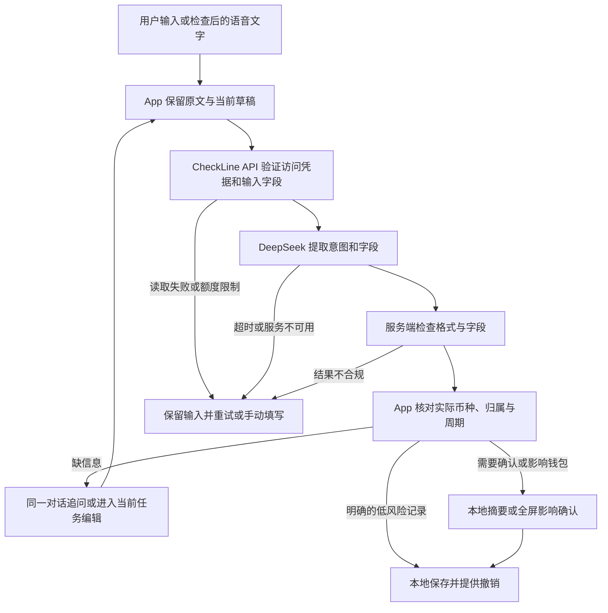

# 小朵 Workflow — 本地审阅与私有联调包

这份服务让小朵把用户的话整理成**意图与字段候选**。**2026-10-16 Rex 已确认当前 Workflow，并授权腾讯云私有部署、IP HTTPS 与个人手机接入。** 目前公网 TLS 和原生真实模型路径已验证；App 有效配置导入后仍由用户首次发送许可，默认本地，不等于公开服务或所有演示业务已实现。

本次确认覆盖当前审阅流程中的追问、归属与周期核对、对象选择、影响确认和异常恢复；不是原生界面、真实模型或新业务功能的验收。退款、已保存消费修改、多笔拆分及复杂追溯的隔离状态继续作为设计契约，真实能力按后续切片另行实施。

2026-10-16 部署前交付自检：同一服务源码从 Git 提取到仓库外独立目录后，275 项本地固定样例、HTTP 和任务检查通过；交付文件包含环境变量模板，不包含真实密钥或 `.env`。当时仅同步确认记录和准备包，未重复原生测试，也尚未验证 Docker、真实模型或公网部署。

2026-10-16 后续部署：按 Rex 授权在腾讯云广州节点完成原生 Node / systemd 内部服务。服务器 275 项检查通过，真实 DeepSeek 的完整消费、缺金额追问、设备时区相对日期 3 个合成样例均返回 200（约 1.4～1.6 秒）。鉴权、未知字段拒绝、演示入口关闭、重启、权限与日志检查通过。Rex 选择先部署内部服务；域名、HTTPS、公网／海外访问和 App 接入未实施。详细版本、证据与维护路径见 [部署记录](../../docs/engineering/evidence/2026-10-16-agent-api-deployment.md)。此前本地验证记录保留为当时事实，不代表这次部署仍未完成。

## 先看流程



服务端没有账本、附件或聊天历史。原文与用户已改字段分别留在手机；关闭、切模式、重启、提交幂等仍由现有任务草稿与领域服务负责。接口返回不是保存指令，也不是金额结果。

修改请求须先明确对象。现有协议不含当前草稿；单独「改成 38 元」保留金额和币种，返回 `needsClarification(action)`。App 应问「你想把哪一项改成 38 元？」并等待回答，不能据此新增消费或默认为修改最近一笔。只有本机已明确定位同一未完成任务时才继续合并；额度走现有本地确认，已保存消费修改先交付隔离设计契约，真实业务须另行实现与验证。

归属核对不能省略。服务端只保留原文明确指向的预算卡名，不将「午餐」或唯一候选当成已选餐饮卡；`capture` 仅表示消费候选。原生与 HTML 契约均按消费日期检查实际卡／周期，单一候选仍先问，多张供选择，允许未纳入；卡内入口和明确点名复用已知归属，冲突、间隔、已结算或失效则拦截。选卡之后才检查现有换算门禁，没有报价不当成零。

任务与异常也必须能继续回答、核对、完成或明确退出。服务端可选 `requestedIntent` 只由程序设置，模型不能伪造。原生先保留完整候选再合并当前任务，字段回答、选卡和确认在本机继续；网络错误不静默采用本地猜测保存。退款、已保存消费修改、多笔拆分与复杂追溯仍为设计契约，原生提供现有详情入口或明确保留／结束，不冒充新业务已接通。

## 本次审阅路径

需要 Node.js 22 或以上。在本目录执行：

```bash
npm test
npm run review
```

打开 `http://127.0.0.1:8787/review#missing-amount`。在「缺少金额」输入 `35元` → 继续 → 选择餐饮或未纳入 → 模拟保存。再查看建卡、修改、退款、心愿、结算与恢复案例。切换案例保留本页输入与选择，确认需重新检查；刷新重置虚构状态。技术候选默认折叠。窄屏使用原生案例选择框。

页面右上可保存独立 HTML；也可执行 `npm run export-review -- /绝对路径/checkline-workflow-review.html`。导出文件内嵌所有案例、服务端实际处理后的候选与同一门禁程序，不依赖本地服务、外部字体、资源或网络请求。`review/index.html` 是生成模板，应交付导出结果。`/review/download.html` 和其他审阅路由仅在回环演示模式可用，真实服务保持 404。

**演示使用固定虚构模型结果，不调用 DeepSeek，也不代表模型准确率。** 演示仅绑定 `127.0.0.1`，响应标记 `X-CheckLine-Mode: demonstration`。退出时停止该进程。

## 接口契约

- `GET /health`：进程就绪状态；不检查 DeepSeek 连通性，不输出密钥或环境变量。
- `POST /v1/agent/interpret`：`Authorization: Bearer <私有联调 Token>`，`Content-Type: application/json`。
- 成功正文直接是现有 `AgentIntentCandidate`，金额是字符串；响应头含随机 `X-Request-ID`、契约版本与运行模式。
- 请求保持现有 `system`、`userMessage`、`context` 三项。`system` 不被执行，服务端提示词是唯一规则来源。`context` 只含预算名称／周期类型／币种、最多 10 个商家名、已有标签，以及可选 `deviceTime: {timestamp, timeZoneIdentifier}`；可只传当前需要的候选项，不应机械发送全部账本投影。
- 16 KiB 请求上限，字段长度和数组数量有限制；未知字段（包括余额、记录列表、客户端工具或上游地址）直接拒绝。
- 允许的候选字段与当前 Swift 模型一致，见 `src/contract.mjs`。在完整仓库中执行 `npm run check-contract` 做对齐检查。`null` 表示未提取到，不得覆盖用户已经修正的字段；具体任务合并和旧结果取消在 App 接入时验证。

虚构请求：

```json
{
  "system": "compatible client prompt; server policy takes precedence",
  "userMessage": "午餐 35 元，记到餐饮预算",
  "context": {
    "budgetCards": [{"name": "餐饮", "cycleType": "repeating", "currencyCode": "CNY"}],
    "recentMerchants": [],
    "tagNames": []
  }
}
```

候选：

```json
{"intentType":"capture","amount":"35","currencyCode":"CNY","merchant":"午餐","budgetName":"餐饮"}
```

服务端不返回预算／周期／消费／心愿 ID；模型不知道这些本机对象。归属仍由 App 在当前账本解析。缺金额、同名预算等进入追问。设备参考时间每次发送重建，仅供 CheckLine API 程序使用，转发模型前剥离。「今天／昨天／前天」消费按设备时区日历日解析，结果使用该日开始的 ISO 时间戳，不能用服务器日期替代。未提供时间、多个日期、区间、未来或不明确表达继续追问；包含具体时刻的表达不静默丢掉时间，仍核对；建卡区间仍核对。预计购买、否定消费、退款不能当作新消费。结算、删除、兑现、追溯只给出本地选对象的追问，不自动修改账本。心愿创建继续使用本地入口，本轮不新增 `createWish` 业务命令。

| HTTP | 错误码 | App 后续承接 |
|---|---|---|
| 400 / 413 / 415 | `invalid_request` / `request_too_large` / `unsupported_content_type` | 保留草稿，检查输入／协议 |
| 401 | `unauthorized` | 保留草稿，恢复联调认证 |
| 429 | `rate_limited` | 等待 `Retry-After` 后由用户重试 |
| 503 | `busy` / `model_unavailable` | 保留输入，手动或重试 |
| 504 | `model_timeout` | 保留输入，明确超时 |
| 502 | `invalid_model_output` | 不采用无效结果，保留草稿 |

错误正文只含稳定错误码与是否可重试，不透传上游正文或思考内容。响应不缓存。每次解析只有一次模型调用，不自动循环重试。默认上游 12 秒超时、每分钟 20 次、并发 2 个；当前 App 15 秒超时，真实云端测试后再一起校准，不能据此宣称真实识别性能达标。

## 服务器部署，再接入 App

Workflow 逻辑已于 2026-10-16 确认；随后 Rex 授权 Codex 执行服务器部署。下列步骤也供 Rex 自行维护；流程确认或服务器部署均不启用 App 网络开关。

服务端使用官方 `deepseek-flash`（当前对应 V4.1 Flash）、启用思考、默认普通档 `high`，上限 4096 tokens，JSON 输出。格式合法仍可能理解错，App 门禁不能省略。[模型名称](https://api-docs.deepseek.com/news/news260910/)、[思考参数](https://api-docs.deepseek.com/guides/thinking_mode/)、[JSON 模式](https://api-docs.deepseek.com/guides/json_mode/)

1. 上传本目录到服务器，确认已安装 Docker Compose，或 Node.js 22+。
2. 复制 `.env.example` 为 `.env`（仅服务器本机保存，文件权限 `chmod 600 .env`），配置 `DEEPSEEK_API_KEY` 与随机 `AGENT_API_TOKEN`。联调 Token 至少 32 个字符，可用 `openssl rand -hex 32` 生成。真实密钥不要贴进源码、镜像或公开文档。
3. 容器运行 `docker compose up -d --build`；它只在服务器回环地址 `127.0.0.1:8787` 暴露 API。宿主反向代理负责 HTTPS；不要把内部 8787 端口直接对公网开放。原生运行可用 `node --env-file=.env src/server.mjs`，默认回环监听。
4. 先确认 `/health`，再从服务器使用合成样例检查模型返回。将 **HTTPS 接口地址**（含 `/v1/agent/interpret`）提供给 Codex，联调凭据经安全配置传递；之后才改 App 网络开关、鉴权、请求取消与隐私授权入口。

本 Token 只支持私有联调，不能作为公开 App 内共用的永久密钥。可选 `AGENT_API_TOKEN_EXPIRES_AT` 使用 ISO 8601，到期在模型调用前返回 401；配置格式错误拒绝启动。当前测试到期为 2026-10-23 14:37:53（北京时间）。公开服务前仍需设备／用户身份、凭据轮换、跨实例计数与地区数据处理方案。国内公网 TLS 与专用模拟器原生真实模型路径已验证；海外、移动网络和公开上线另验。

### 腾讯云原生 Node / systemd 部署

不强制安装 Docker。`deploy/install-systemd.sh <上传后解压目录> <release标识>` 为已授权服务器准备独立版本与守护进程：从 Node.js 官方下载固定版本并校验 SHA-256，使用 `checkline-agent` 无登录账号，服务监听回环地址。脚本不创建密钥、不输出环境变量、不自动启动未配置的服务。`deploy/checkline-agent.service` 是唯一 systemd 配置来源。

- 程序：`/opt/checkline-agent/releases/<release标识>`，`current` 指向使用版本；`previous` 保留上一个版本。
- 运行时：`/opt/checkline-agent/node/bin/node`，固定 Node.js 24.22.0；SHA-256 来自官方发布目录，升级时同时更新安装脚本并重新验证。
- 凭据：`/etc/checkline-agent/agent.env`，目录 `0700`、文件 `0600`、root 所有；包含 `DEEPSEEK_API_KEY`、随机 `AGENT_API_TOKEN`、可选 `AGENT_API_TOKEN_EXPIRES_AT`、`BIND_ADDRESS=127.0.0.1`、`PORT=8787`、`AGENT_DEMO_MODE=0`。不设置空壳或演示密钥来伪装真实服务。
- 启动：凭据配置完成后执行 `systemctl enable --now checkline-agent`；检查 `systemctl is-active checkline-agent` 以及 `http://127.0.0.1:8787/health`。健康检查只证明进程就绪，真实模型必须另外使用合成输入验证。
- 维护：`systemctl restart checkline-agent`；`journalctl -u checkline-agent -n 30 --no-pager` 仅应含安全元数据。服务限 256 MiB 内存、64 个任务，以非 root 身份运行，源码与系统目录只读。
- 回退：先记录 `readlink -f /opt/checkline-agent/previous`，将 `current` 原子改回该目录后重启；如首次部署需要停用，执行 `systemctl disable --now checkline-agent`，保留版本与凭据以便恢复，不删账本或其他服务。
- HTTPS：当前使用 `https://123.207.2.148/v1/agent/interpret`，Caddy 2.11.7 与 Let’s Encrypt IP 短期证书，不跳过系统 TLS 校验、不安装自签名根证书。配置来源 `deploy/Caddyfile` 与 `deploy/checkline-tls.service`；证书状态保存在 `/var/lib/checkline-tls`。仅代理健康检查与解析接口，其余 404，访问日志关闭，内部 8787 不对外开放。既有 80 用于证书挑战，本次经 Rex 确认仅新增公网 TCP 443。自动续期已配置，尚未观察后续真实续期周期；维护查看 `systemctl status checkline-tls`。

### 私有手机配置与原生验证

- 模型密钥不进入 App。安装时通过一次性私有文件导入接口、服务 Token 与到期时间到 Keychain（仅此设备、解锁可用），随后删除传输文件；不写入二进制、UserDefaults 或日志。
- 第一次发送前可选择云端或继续本地；设置可关闭。预算名称／币种按当前任务最少候选发送，历史商家和标签数组为空，不传完整账本、聊天历史或图片。
- 普通原生测试使用注入 HTTP，不消费真实模型。真实 UI 测试必须在新建空白、私有配置的专用模拟器，以 `TEST_RUNNER_CHECKLINE_LIVE_AGENT_UI=1` 显式运行 `CloudAgentLiveUITests`；未设标记时跳过。不得将它指向包含用户账本的设备。
- 本轮实际测试、截图、录像、手机安装与尚未验证项见 [手机接入记录](../../docs/engineering/evidence/2026-10-16-agent-phone-integration.md)。既有 49 个隔离页面案例不等于原生全部实现。

## 实现与检查边界

`src/` 是固定 Workflow、HTTP 服务与 DeepSeek 协议；`test/` 使用注入模型和真实本地 HTTP，检查隐私字段、格式、异常、鉴权、速率、并发、取消与日志；`review/capture-flow.mjs` 与 `review/task-flow.mjs` 是 HTML 与测试共用的本机门禁／任务隔离契约，不进入真实 API 的账本执行。`render.mjs` 用固定 Provider 经过真正的 Workflow 生成原始案例候选；新增变化明确标记故障注入，不将预填 `expected` 冒充程序输出。稳定 ID、周期、十进制金额投影和固定报价都只属于虚构演示，不加入上传允许清单。单进程限制适用于私有联调，多实例需要共享计数。没有第三方运行时依赖、遥测、真实账本余额计算或第三方工具执行。

### 2026-10-13 实际验证

- Node.js 24.16.0：60 项服务端检查通过，包含 15 个固定案例逐项核对与真实本地 HTTP 往返；DeepSeek 请求协议、JSON/字段异常、隐私白名单、凭据、速率、并发、取消和日志均有检查。
- 候选的 22 个字段与现有 Swift 定义、既有意图路由对齐检查通过。
- Xcode 27 / iPhone 18 Pro / iOS 27：18 项 Swift Testing（3 suites）通过，其中新增 2 项使用同一固定样例证明原生解码、Decimal、月度区间草稿兼容且未写账本；其余是既有 AgentSession 与连续对话回归。结果包 `/tmp/checkline-agent-workflow-20261013-0840.xcresult`。
- 审阅页已真实打开并点击「缺少金额」与「模型超时」，候选、失败状态和下一步正确刷新；[审阅截图](../../docs/engineering/evidence/2026-10-13-agent-workflow-review.jpg)。此页面是开发审阅材料，不是 App 的新界面。
- 本机 Docker 未启动，Docker 镜像构建及 Compose 运行未验证；当前通过的是原生 Node 服务。没有使用真实密钥、真实模型或公网服务器，没有修改 App 网络开关、手机安装或用户账本。

### 2026-10-14 修改对象追问修正

- 「继续当前草稿」改为「修改对象不明」：单独「改成38元」保留金额／币种，返回 `needsClarification(action)`，审阅页显示「等待回答 · 尚未执行」和具体追问。不假定当前草稿或最近一笔；相对日期修改也丢弃模型猜测的日期。
- 70 项服务端检查通过（新增 10 项，含中英文修改被误判为消费、预算修改仍需选周期、相对日期与正常消费边界），15 个固定案例的真实本地 HTTP 往返和 22 个候选字段对齐继续通过。
- Xcode 27 / iOS 26.5：3 项原生契约检查通过，包含新增「修改对象不明确只能追问」；结果包 `/tmp/checkline-agent-edit-target-ios26-20261014.xcresult`。初次 iOS 27 测试因模拟器服务连接异常中止，未据此宣称通过。
- 审阅页实际刷新并点击「修改对象不明」，追问、保留金额及未执行状态均可见；[修正截图](../../docs/engineering/evidence/2026-10-14-agent-edit-clarification.jpg)。本轮未修改 App 产品源码、启用云端、安装手机或调用真实模型；真实多轮候选保留与任务定位仍须后续接入验证。

通过固定样例只证明程序能处理这些状态，不能作为真实模型、App 接入或云端测试通过的证据。下一阶段接入 App 时，除 endpoint 外还须改造自然语言请求路由（当前 Workspace 会先处理本地可识别的输入）、私有联调鉴权、错误分类、任务取消与候选合并，并验证所有失败不会被误当作成功保存。Rex 的 Workflow 审阅门槛保持开放。

### 2026-10-14 设备时间与日期解析

- App 请求准备层每次以回合 `now` 和系统时区构建 `context.deviceTime`；不存到草稿、不增加位置权限、不启用云端。旧上下文和旧请求没有此字段仍兼容。
- 消费「今天／昨天／前天」及英文等价表达由程序计算当地日历日，返回可被现有原生核对与 `TaskDraft.apply` 接收的 ISO 时间戳。明确日期替换模型猜测；午夜、跨月／年、闰年、非整点时区、夏令时 23／25 小时日及午夜跳时均有检查，历史整天跳过时继续追问。具体时刻或不明确／多个日期继续核对，不编造实际消费时刻。
- 108 项服务端检查通过，17 个固定案例（15 个有效候选），候选 22 字段、上下文 4 字段与设备时间 2 字段对齐通过。时间和时区在上游模型消息中剥离、旧请求兼容、错误时区／时间戳在调用模型前拒绝都有检查。
- Xcode 27 / iOS 26.5：35 项原生 Agent 检查（8 suites）通过，包含新增日期进入核对／草稿、发送时参考不漂移、旧上下文兼容与固定时区规范化。初轮旧上下文字段白名单断言失败，已按新契约更新并原组复测通过；结果 `/tmp/checkline-device-time-retry-20261014.xcresult`。
- 浏览器实际点击「按设备日期解析」「跨时区日期」「缺少设备时间」：同一示例时刻在上海将昨天解析为10月13日，在洛杉矶为10月12日；旧请求继续追问。[审阅截图](../../docs/engineering/evidence/2026-10-14-agent-device-time.jpg)。示例参考时间固定，未读取手机时钟或真实账本；真实模型、App 云端接入、手机和 Docker 仍未验证，未安装手机。现有 App 本地优先路由、跨时区切换后的展示与多轮日期合并仍须在接入阶段验证。

### 2026-10-15 预算归属与周期核对

- 服务端收紧明确点名的证据；消费描述、单一候选或模型猜中的有效卡名都不能代替用户选择，缺金额／日期时也不保留推测归属。对无法确定的表达继续交给本机询问，不声称这些有限规则证明真实语言理解准确率。
- 可点击 HTML 与隔离门禁覆盖：单一／多张／同名卡、明确点名、卡内入口、冲突、日期间隔、过去待结算期、已结算期、队列、明确未纳入，以及先选卡后换算。任务、字段或周期变化让旧回答失效；报价需匹配原币、金额、卡和周期，有效且确认后才放行演示。没有报价不能当零。额外拦住「退款」被模型误判为删除的选对象路径；未新增退款业务。
- Node.js 24.16.0：180 项检查通过，含 27 个固定案例、真实本地 HTTP、门禁与错误／隐私回归；22 个候选字段、4 个上下文字段与 2 个时间字段对齐通过。初轮导出发现字符串替换会展开脚本中的 `$&`，改为回调插入后完整复测通过。结果日志 `/tmp/checkline-workflow-attribution-20261015.log`。
- 在内置浏览器实际操作单卡询问、取消／继续、模拟保存／撤销、同名卡选择、入口冲突、间隔改卡、上一期、已结算拦截、队列、换算确认、缺报价重试、字段变化重问、未纳入与退款拦截；控制台没有错误／警告。[归属截图](../../docs/engineering/evidence/2026-10-15-agent-attribution-review.jpg) 为实际 422 CSS px 页面。视口覆盖请求未改变实际宽度，因此不宣称 375 px 或桌面宽屏已验证；已恢复临时覆盖设置。
- HTML 已导出且无外部资源／请求，下载端点与嵌入脚本语法有检查；内置浏览器拒绝 `file:` 协议，没有绕过，因此直接双击本地文件的浏览器行为未实测。本次不运行新的 Swift 测试：原生产品源码和候选协议字段没有变化。没有启用 App 云端、调用真实模型／汇率、测试 Docker、公网或安装手机。
- 原生接入仍须落实同样门禁并修复已定位的两处路径：模型卡名直接变为 CaptureDraft 的预算 ID，以及仅带预算 ID 时执行可能忽略已选卡。届时增加原生针对性回归，不能以此 HTML 关闭原生验收。Rex 确认 → Rex 部署并提供 HTTPS 地址 → App 接入与真实云端测试的门槛保持。

### 2026-10-15 任务与异常承接修复

- 追问新增可选 `requestedIntent`，服务端保留已知原动作和已提取字段。模型结构不包含该提示，伪造会被拒绝；意图不明仍先选动作。Swift 只增加可选解码兼容，旧候选继续可读，不启用云端或直接执行。
- 共用任务支持逐项回答、手动接管、原对象选择、影响核对、完成／撤销与明确退出。未发送表单输入及本页草稿可在切案例后恢复；切换、改值、对象失效或取消使旧确认／回调失效，购买和覆盖确认重新勾选。刷新不恢复虚构任务，也不冒充原生跨重启草稿。
- 建卡显示实际月度／一次性日期，可重开修改；查询只读结束；额度只作用当前可编辑月度期与以后默认值。未到期结算只预估，到期结算先处理待确认，再核对钱包与覆盖。心愿创建不扣余额，兑现核对实际购买及币种，余额不足可转普通消费或保留输入。
- 退款先选原消费：多条选择、一条确认、无匹配补日期／手动找／结束；部分退款保留原记录，退款上限扣除已退部分。「昨天」按演示设备日历日查找。普通删除、修改和迟到记录分别核对原周期；缺原换算依据、已结算普通删除及部分退款后普通删除明确阻止，原记录保留。退款／已保存消费修改／多笔拆分／追溯均为设计演示，未新增真实业务命令。
- 错误可走重试成功、手动接管、暂停或结束；涵盖格式异常、超时、断网、认证和限流。保存前失败可修改；保存后响应中断只恢复同一结果；附件失败只补附件，先看结果后仍留补齐入口。暂停不会把恢复任务变回新增消费。缺报价不作零，改金额重取并再次确认，示例显示固定虚构汇率、来源和时间。
- Node.js 24.16.0：**275 项检查通过**，包含 35 个服务端固定案例、49 个页面案例逐项走到完成或明确结束、精确十进制投影、旧回调、确认失效、同一提交恢复、附件续传与既有 HTTP／隐私回归。候选 23 字段、上下文 4 字段与设备时间 2 字段对齐通过。初轮发现模拟消费修改漏更新预算、一次性日期编辑无效及恢复状态回退，已修正并增加回归。日志 `/tmp/checkline-workflow-completion-20261015.log`。
- Xcode 27 / iOS 26.5：**36 项原生 Agent 检查（8 suites）通过**，包含新增旧／新候选兼容及高影响提示不越过确认；结果包 `/tmp/CheckLineWorkflowComplete20261015.xcresult`。没有改原生任务路由，没有据此声称实际 Agent、退款或多轮合并已接通。
- 422 CSS px 内置浏览器实际操作：连续补充与选卡、未发送输入切换恢复、建卡和重开日期、月度跨月区间、查询／额度、修改已有消费、心愿创建／兑现／不足、待确认回到结算、只读预估、部分／多条／无匹配退款、逐笔拆分、换算改值与重取、取消请求、错误重试／手动接管、保存前失败／返回中断／附件恢复。页面无横向溢出，控制台无错误／警告。[追问截图](../../docs/engineering/evidence/2026-10-15-agent-task-flow-input.jpg)、[退款截图](../../docs/engineering/evidence/2026-10-15-agent-task-flow-refund.jpg)、[结算截图](../../docs/engineering/evidence/2026-10-15-agent-task-flow-settlement.jpg)、[恢复截图](../../docs/engineering/evidence/2026-10-15-agent-task-flow-recovery.jpg)。截图供审阅流程，不代表原生最终 UI。
- 独立 HTML 的嵌入脚本语法、无外部资源、下载端点与导出内容一致检查通过。直接 `file:` 打开仍未实测；没有新增操作录屏，也未验证桌面宽屏、真实触摸／VoiceOver、真实模型／汇率／附件服务、Docker、公网或手机安装。App 云端仍关闭；原生候选合并、归属缺口、错误分类与取消继续留在接入阶段，Rex 审阅门槛不变。
