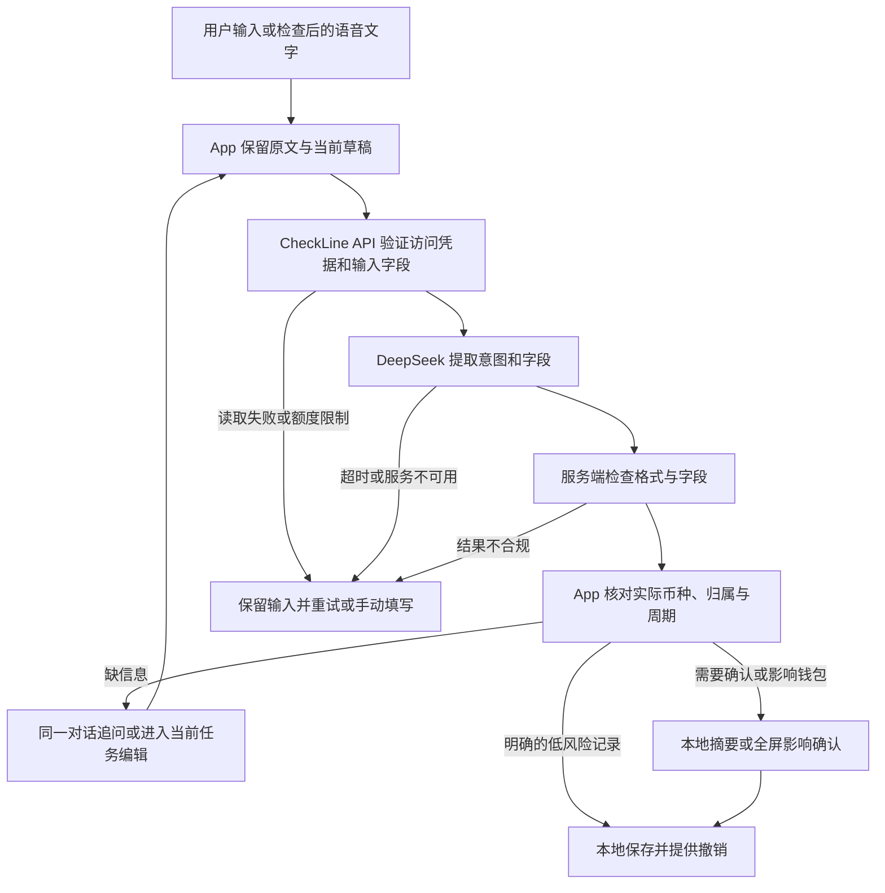

# 小朵 Workflow — 本地审阅与私有联调包

这份服务让小朵把用户的话整理成**意图与字段候选**。本轮先确认流程，Rex 部署到服务器并提供 HTTPS 地址之后，再接入 App、测试真实 DeepSeek 和手机表现。当前 App 云端仍关闭。

## 先看流程



服务端没有账本、附件或聊天历史。原文与用户已改字段分别留在手机；关闭、切模式、重启、提交幂等仍由现有任务草稿与领域服务负责。接口返回不是保存指令，也不是金额结果。

修改请求须先明确对象。现有协议不含当前草稿；单独「改成 38 元」保留金额和币种，返回 `needsClarification(action)`。App 应问「你想把哪一项改成 38 元？」并等待回答，不能据此新增消费或默认为修改最近一笔。只有本机已明确定位同一未完成任务时才继续合并；修改已保存记录或预算额度使用既有本地入口及确认门禁，后续 App 接入时分别验证。

## 本次审阅路径

需要 Node.js 22 或以上。在本目录执行：

```bash
npm test
npm run review
```

打开 `http://127.0.0.1:8787/review`。选择消费、缺项、建卡、愿望、拒绝、失败等案例，查看候选及 App 应如何承接。

**演示使用固定虚构模型结果，不调用 DeepSeek，也不代表模型准确率。** 演示仅绑定 `127.0.0.1`，响应标记 `X-CheckLine-Mode: demonstration`。退出时停止该进程。

## 接口契约

- `GET /health`：进程就绪状态；不检查 DeepSeek 连通性，不输出密钥或环境变量。
- `POST /v1/agent/interpret`：`Authorization: Bearer <私有联调 Token>`，`Content-Type: application/json`。
- 成功正文直接是现有 `AgentIntentCandidate`，金额是字符串；响应头含随机 `X-Request-ID`、契约版本与运行模式。
- 请求保持现有 `system`、`userMessage`、`context` 三项。`system` 不被执行，服务端提示词是唯一规则来源。`context` 只含预算名称／周期类型／币种、最多 10 个商家名、已有标签；可只传当前需要的候选项，不应机械发送全部账本投影。
- 16 KiB 请求上限，字段长度和数组数量有限制；未知字段（包括余额、记录列表、客户端工具或上游地址）直接拒绝。
- 允许的候选字段与当前 Swift 模型一致，见 `src/contract.mjs`。在完整仓库中执行 `npm run check-contract` 做对齐检查。`null` 表示未提取到，不得覆盖用户已经修正的字段；具体任务合并和旧结果取消在 App 接入时验证。

虚构请求：

```json
{
  "system": "compatible client prompt; server policy takes precedence",
  "userMessage": "午餐 35 元，记到餐饮预算",
  "context": {
    "budgetCards": [{"name": "餐饮", "cycleType": "repeating", "currencyCode": "CNY"}],
    "recentMerchants": [],
    "tagNames": []
  }
}
```

候选：

```json
{"intentType":"capture","amount":"35","currencyCode":"CNY","merchant":"午餐","budgetName":"餐饮"}
```

服务端不返回预算／周期／消费／心愿 ID；模型不知道这些本机对象。归属仍由 App 在当前账本解析。缺金额、同名预算、相对日期等进入追问；没有本机参考时间时不得用服务器日期猜测“昨天”。预计购买、否定消费、退款不能当作新消费。结算、删除、兑现、追溯只给出本地选对象的追问，不自动修改账本。心愿创建继续使用本地入口，本轮不新增 `createWish` 业务命令。

| HTTP | 错误码 | App 后续承接 |
|---|---|---|
| 400 / 413 / 415 | `invalid_request` / `request_too_large` / `unsupported_content_type` | 保留草稿，检查输入／协议 |
| 401 | `unauthorized` | 保留草稿，恢复联调认证 |
| 429 | `rate_limited` | 等待 `Retry-After` 后由用户重试 |
| 503 | `busy` / `model_unavailable` | 保留输入，手动或重试 |
| 504 | `model_timeout` | 保留输入，明确超时 |
| 502 | `invalid_model_output` | 不采用无效结果，保留草稿 |

错误正文只含稳定错误码与是否可重试，不透传上游正文或思考内容。响应不缓存。每次解析只有一次模型调用，不自动循环重试。默认上游 12 秒超时、每分钟 20 次、并发 2 个；当前 App 15 秒超时，真实云端测试后再一起校准，不能据此宣称真实识别性能达标。

## Rex 确认后部署

服务端使用官方 `deepseek-flash`（当前对应 V4.1 Flash）、启用思考、默认普通档 `high`，上限 4096 tokens，JSON 输出。格式合法仍可能理解错，App 门禁不能省略。[模型名称](https://api-docs.deepseek.com/news/news260910/)、[思考参数](https://api-docs.deepseek.com/guides/thinking_mode/)、[JSON 模式](https://api-docs.deepseek.com/guides/json_mode/)

1. 上传本目录到服务器，确认已安装 Docker Compose，或 Node.js 22+。
2. 复制 `.env.example` 为 `.env`（仅服务器本机保存，文件权限 `chmod 600 .env`），配置 `DEEPSEEK_API_KEY` 与随机 `AGENT_API_TOKEN`。联调 Token 至少 32 个字符，可用 `openssl rand -hex 32` 生成。真实密钥不要贴进源码、镜像或公开文档。
3. 容器运行 `docker compose up -d --build`；它只在服务器回环地址 `127.0.0.1:8787` 暴露 API。宿主反向代理负责 HTTPS；不要把内部 8787 端口直接对公网开放。原生运行可用 `node --env-file=.env src/server.mjs`，默认回环监听。
4. 先确认 `/health`，再从服务器使用合成样例检查模型返回。将 **HTTPS 接口地址**（含 `/v1/agent/interpret`）提供给 Codex，联调凭据经安全配置传递；之后才改 App 网络开关、鉴权、请求取消与隐私授权入口。

本 Token 只支持私有联调，不能作为公开 App 内共用的永久密钥。公开服务前仍需选定设备／用户身份、短期凭据、跨实例用量计数和地区数据处理方案。腾讯云／阿里云的公网部署、TLS、真实模型可用性、海外访问、公开上线手续和手机测试本轮未验证。

## 实现与检查边界

`src/` 是固定 Workflow、HTTP 服务与 DeepSeek 协议；`test/` 使用注入模型和真实本地 HTTP，检查隐私字段、格式、异常、鉴权、速率、并发、取消与日志；`review/` 是隔离案例展示。单进程限制适用于私有联调，多实例需要共享计数。没有第三方运行时依赖，没有遥测、余额计算或第三方工具执行。

### 2026-10-13 实际验证

- Node.js 24.16.0：60 项服务端检查通过，包含 15 个固定案例逐项核对与真实本地 HTTP 往返；DeepSeek 请求协议、JSON/字段异常、隐私白名单、凭据、速率、并发、取消和日志均有检查。
- 候选的 22 个字段与现有 Swift 定义、既有意图路由对齐检查通过。
- Xcode 27 / iPhone 18 Pro / iOS 27：18 项 Swift Testing（3 suites）通过，其中新增 2 项使用同一固定样例证明原生解码、Decimal、月度区间草稿兼容且未写账本；其余是既有 AgentSession 与连续对话回归。结果包 `/tmp/checkline-agent-workflow-20261013-0840.xcresult`。
- 审阅页已真实打开并点击「缺少金额」与「模型超时」，候选、失败状态和下一步正确刷新；[审阅截图](../../docs/engineering/evidence/2026-10-13-agent-workflow-review.jpg)。此页面是开发审阅材料，不是 App 的新界面。
- 本机 Docker 未启动，Docker 镜像构建及 Compose 运行未验证；当前通过的是原生 Node 服务。没有使用真实密钥、真实模型或公网服务器，没有修改 App 网络开关、手机安装或用户账本。

### 2026-10-14 修改对象追问修正

- 「继续当前草稿」改为「修改对象不明」：单独「改成38元」保留金额／币种，返回 `needsClarification(action)`，审阅页显示「等待回答 · 尚未执行」和具体追问。不假定当前草稿或最近一笔；相对日期修改也丢弃模型猜测的日期。
- 70 项服务端检查通过（新增 10 项，含中英文修改被误判为消费、预算修改仍需选周期、相对日期与正常消费边界），15 个固定案例的真实本地 HTTP 往返和 22 个候选字段对齐继续通过。
- Xcode 27 / iOS 26.5：3 项原生契约检查通过，包含新增「修改对象不明确只能追问」；结果包 `/tmp/checkline-agent-edit-target-ios26-20261014.xcresult`。初次 iOS 27 测试因模拟器服务连接异常中止，未据此宣称通过。
- 审阅页实际刷新并点击「修改对象不明」，追问、保留金额及未执行状态均可见；[修正截图](../../docs/engineering/evidence/2026-10-14-agent-edit-clarification.jpg)。本轮未修改 App 产品源码、启用云端、安装手机或调用真实模型；真实多轮候选保留与任务定位仍须后续接入验证。

通过固定样例只证明程序能处理这些状态，不能作为真实模型、App 接入或云端测试通过的证据。下一阶段接入 App 时，除 endpoint 外还须改造自然语言请求路由（当前 Workspace 会先处理本地可识别的输入）、私有联调鉴权、错误分类、任务取消与候选合并，并验证所有失败不会被误当作成功保存。Rex 的 Workflow 审阅门槛保持开放。
